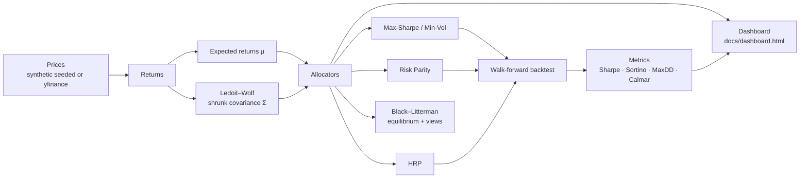

# Portfolio Optimizer


**A portfolio-construction toolkit that goes past textbook Markowitz.** Five
allocation frameworks — Markowitz max-Sharpe / min-volatility, **Risk Parity**,
**Hierarchical Risk Parity**, and **Black–Litterman** — built on a
**Ledoit–Wolf shrunk covariance**, and judged the only honest way: an
**expanding-window walk-forward backtest** where no strategy ever sees the
future it is tested on.

> 📊 **[Open the interactive dashboard](docs/dashboard.html)** — a single
> self-contained HTML file (no CDN, works offline) with the efficient frontier
> and the backtest growth curves, rendered from data computed by this code.

---

## Headline results — walk-forward backtest

Seeded synthetic universe (AAPL, MSFT, GOOGL, AMZN, JPM, XOM), 756 trading
days, 252-day initial training window, 63-day rebalancing steps,
Ledoit–Wolf covariance, **504 out-of-sample days**. Reproduce with
`python main.py --backtest`:

| Strategy | Annual return | Volatility | Sharpe | Sortino | Max drawdown | Calmar | $10,000 grew to |
|---|---:|---:|---:|---:|---:|---:|---:|
| Equal Weight | 12.70% | 14.93% | 0.741 | 1.079 | −22.45% | 0.566 | $12,701.25 |
| **Max-Sharpe** | **22.84%** | 19.09% | **1.068** | **1.657** | **−18.42%** | **1.240** | **$15,089.29** |
| Min-Volatility | 11.35% | **13.64%** | 0.710 | 1.036 | −20.34% | 0.558 | $12,398.48 |
| Risk Parity | 12.81% | 14.27% | 0.776 | 1.129 | −20.88% | 0.613 | $12,725.90 |
| HRP | 12.03% | 13.83% | 0.746 | 1.084 | −21.12% | 0.570 | $12,551.11 |

Read it honestly: Max-Sharpe wins this sample *and* carries the highest
volatility; Min-Volatility and HRP deliver the calmest ride; Risk Parity
edges out 1/N on Sharpe with less volatility. One seeded sample proves
nothing about live markets — it proves the machinery runs, compares
fairly, and reports its own drawdowns.

## Features

- **Five allocators** — Equal Weight, Max-Sharpe, Min-Volatility, Risk
  Parity (equal risk contribution), HRP, plus a full Black–Litterman
  posterior engine with investor views
- **Ledoit–Wolf covariance shrinkage**, implemented from the 2004 paper
  in pure NumPy (δ = 0.0228 on the demo sample — small, because 504
  observations for 6 assets is already a well-conditioned problem)
- **Walk-forward backtest** — expanding window, weights estimated only
  from history, Sharpe / Sortino / max drawdown / Calmar from realised
  out-of-sample returns
- **Efficient frontier** and 5,000-portfolio random sampling
- **Monte Carlo** wealth simulation (max-Sharpe demo: median $12,097.18
  after 1 year on $10,000, 5th–95th percentile $9,071.42–$16,068.49,
  probability of loss 15.50%)
- **Offline by design** — seeded synthetic data generator with a shared
  market factor, so the whole pipeline (demo, backtest, dashboard,
  tests) runs with no internet; optional `yfinance` download path for
  real data
- **29 pytest tests**, including allocator invariants (risk-parity
  contributions equal to within tolerance, HRP inverse-variance splits,
  Black–Litterman posterior pulled toward — not onto — a view)

## Architecture



## Quickstart

```bash
pip install -r requirements.txt        # numpy, pandas, scipy
python main.py                         # full demo: all allocators + frontier + Monte Carlo
python main.py --backtest              # + walk-forward comparison table
python src/backtest.py                 # backtest only
python src/dashboard.py                # regenerate docs/dashboard.html
pip install -r requirements-dev.txt    # adds pytest
python -m pytest tests -q              # 29 tests
```

## Project structure

```
portfolio-optimizer/
├── main.py                      # CLI demo (offline, seeded)
├── src/
│   ├── portfolio_optimizer.py   # core MPT: stats, frontier, max-Sharpe,
│   │                            # min-vol, Monte Carlo, synthetic data
│   ├── covariance.py            # Ledoit–Wolf shrinkage (pure NumPy)
│   ├── allocators.py            # Risk Parity, HRP, Black–Litterman
│   ├── backtest.py              # walk-forward engine + performance metrics
│   └── dashboard.py             # generates the offline HTML dashboard
├── docs/dashboard.html          # self-contained interactive dashboard
├── examples/quickstart.py
└── tests/                       # 29 tests (core + allocators + backtest)
```

## The methods

**Markowitz / max-Sharpe.** Maximise $(w^\top\mu - r_f) / \sqrt{w^\top\Sigma w}$
over long-only, fully-invested $w$ (SciPy SLSQP).

**Ledoit–Wolf shrinkage.** $\Sigma_{LW} = (1-\delta)\,\Sigma_{sample} + \delta\, m I$
with $m = \mathrm{tr}(\Sigma_{sample})/N$ and $\delta$ estimated by minimising
expected Frobenius loss — better conditioned, less extreme weights.

**Risk Parity.** Each asset contributes equally to portfolio variance:
$w_i(\Sigma w)_i = \sigma_p^2 / N$. Solved exactly via Spinu's convex
reformulation $\min_x \tfrac{1}{2} x^\top \Sigma x - \sum_i b_i \log x_i$.

**Hierarchical Risk Parity (López de Prado, 2016).** Cluster on the
correlation distance $d_{ij} = \sqrt{\tfrac{1}{2}(1-\rho_{ij})}$,
quasi-diagonalise Σ, then allocate down the dendrogram by recursive
bisection, splitting capital in inverse proportion to cluster variances.
No inversion, no μ — stability by construction.

**Black–Litterman.** Equilibrium returns $\Pi = \lambda \Sigma w_{mkt}$ from
reverse optimisation; views $P\mu = Q$ with uncertainty $\Omega$ blend to a
posterior $\mu_{BL}$, which is then optimised for maximum utility
$w^\top\mu_{BL} - \tfrac{\lambda}{2} w^\top \Sigma_{post} w$. In the demo,
views *AMZN → 20%* and *JPM → 4%* move AMZN's implied return from 5.6%
(equilibrium) to 12.6% (posterior) — toward the view, not onto it.

**Walk-forward backtest.** Expanding window: train on all history to
date, hold weights for 63 days, record out-of-sample returns, repeat.
Metrics are computed from that realised stream only.

## Limitations

- Demo data is **synthetic** (GBM with a shared market factor): kind to
  every strategy and nothing like real return tails, regimes or costs.
- No transaction costs, slippage, taxes or turnover penalty in the
  backtest; rebalancing is free, which flatters active allocators.
- Long-only, no leverage, no shorting; Black–Litterman demo views are
  illustrative, not research.
- Past (or simulated) performance does not predict future results.

## License

MIT — see [LICENSE](LICENSE).

*Educational project. Nothing here is investment advice.*
